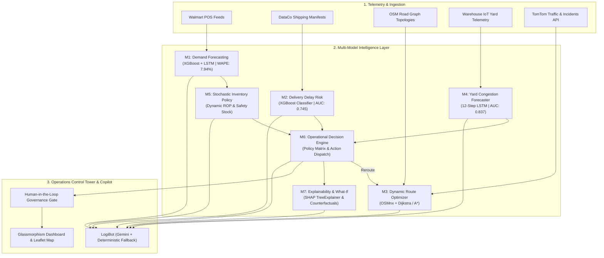

# 🚚 LogiYantra — Autonomous Logistics Intelligence
> **"Think Smarter. Move Faster."**

[](https://python.org)
[](https://flask.palletsprojects.com/)
[]()
[-purple.svg)]()
[]()

---

## 📌 Executive Summary

**LogiYantra** is an enterprise-grade autonomous supply chain control tower designed to resolve the $1.7T global supply chain disruption crisis. Traditional enterprise resource planning (ERP) and warehouse management systems (WMS) are historically descriptive; LogiYantra is **predictive and autonomous**.

By uniting 7 specialized machine learning and mathematical optimization engines, LogiYantra forecasts demand, detects carrier delivery delays before SLA failure, calculates multi-criteria transit corridors, foresees warehouse dock bottlenecks, and computes stochastic safety stock—all orchestrated by an autonomous decision engine and **LogiBot**, a real-time conversational copilot.

---

## 🏗️ System Architecture



---

## 🧩 The 7 Core Intelligence Modules

| Module | Core Algorithm | Dataset / Benchmark | Key Performance Metric |
| :--- | :--- | :--- | :--- |
| **M1: Demand Forecasting** | XGBoost Regressor + LSTM Ensemble | Walmart Store Sales (45 Stores, 81 Depts) | **7.94% WAPE** (92.06% accuracy, RMSE: 2,611.80) |
| **M2: Delivery Delay Risk** | Calibrated XGBoost Classifier | DataCo Global Supply Chain (180k+ records) | **ROC-AUC: 0.7453**, Calibrated Threshold = 0.36 |
| **M3: Route Optimization** | OSMnx Road Graph + Dijkstra / A* | OpenStreetMap Topologies + TomTom API | Deterministic multi-criteria routes with offline fallback |
| **M4: Warehouse Congestion** | Bidirectional LSTM (12-hr sequence) | Multi-variable Yard Telemetry (8 signals) | **ROC-AUC: 0.837**, 76.62% Test Accuracy |
| **M5: Inventory Policy** | Stochastic ROP & Safety Stock Equations | Dynamic lead-time demand & pack sizes | \(ROP = \bar{d} \cdot L + Z \sigma_c \sqrt{L}\), Tri-State health |
| **M6: Decision Engine** | Cross-Module Policy Matrix | Synthesizes M1, M2, M4, M5 inputs | Ranked directives: `REROUTE`, `EXPEDITE`, `STAGGER` |
| **M7: Explainability & What-If** | SHAP TreeExplainer + Counterfactuals | Global model attributions | Feature impact decompositions & scenario deltas |

---

## 🤖 LogiBot — Supply Chain Copilot

LogiBot is an in-app conversational assistant directly connected to the live telemetry of all 7 modules:
- **Hybrid AI Execution:** Powered by Google Gemini (`gemini-flash` / `gemini-3.8-flash`) with automatic, zero-crash fallback to a built-in deterministic rule engine.
- **Natural Language Diagnostics:** Ask about model accuracies, current carrier risks, dock queue estimates, or run What-If simulations (e.g., *"What happens if lead time slips by 3 days and fuel spikes 20%?"*).

---

## 📊 Presentation Suite

The repository includes a complete presentation suite:
- **PowerPoint File:** [`LogiYantra_Presentation.pptx`](./LogiYantra_Presentation.pptx) (16-slide 16:9 widescreen presentation)
- **Interactive Web Deck:** [`LogiYantra_Presentation.html`](./LogiYantra_Presentation.html) (Run in any browser with keyboard controls, notes drawer, and fullscreen mode)
- **PDF Deck:** [`LogiYantra_Presentation.pdf`](./LogiYantra_Presentation.pdf) (High-resolution landscape 16:9 document)

---

## 🚀 Quick Start

### 1. Clone & Setup
```bash
git clone https://github.com/Shrey-As1/LogiYatra.git
cd LogiYatra
```

### 2. Install Dependencies
```bash
python -m pip install -r requirements/requirements.txt
```

### 3. Configure Environment
Copy the example environment file:
```bash
cp .env.example .env
```
Add your optional API credentials inside `.env`:
```ini
TOMTOM_API_KEY=your_tomtom_api_key_here
GEMINI_API_KEY=your_gemini_api_key_here
```
*(Note: If left blank or using placeholders, LogiYantra runs in 100% resilient offline fallback mode.)*

### 4. Launch the Platform
```bash
python app.py
```
Open your browser and navigate to:
- **Control Tower Dashboard:** `http://127.0.0.1:5000/dashboard.html`
- **Interactive Presentation:** `http://127.0.0.1:5000/presentation.html`

---

## 🧪 Testing

Run the automated test suite across all modules and REST API endpoints:
```bash
pytest tests/
```

---

## 📄 License
MIT License. Developed for autonomous, resilient supply chain operations.
